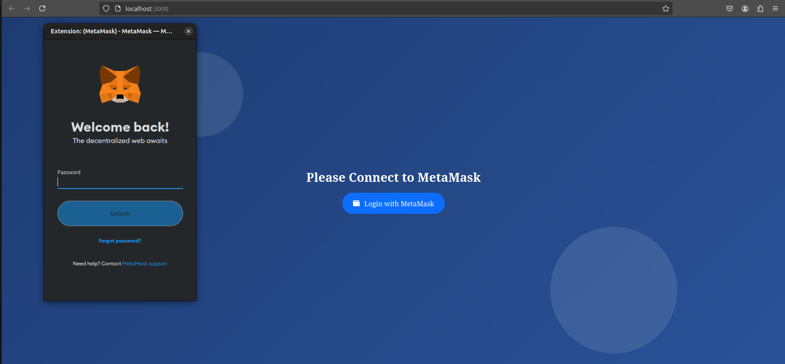
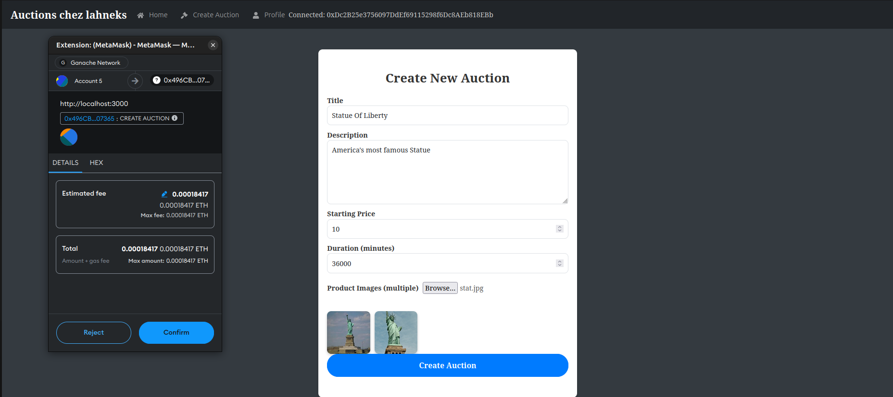
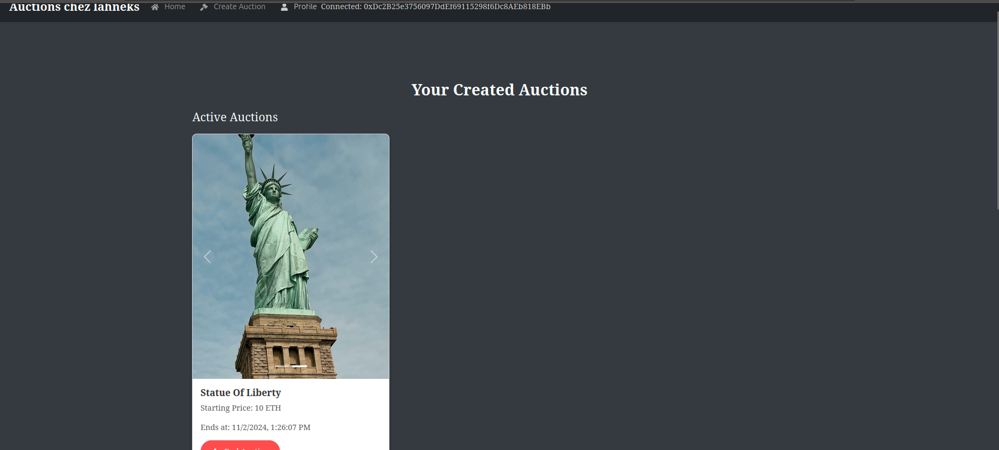
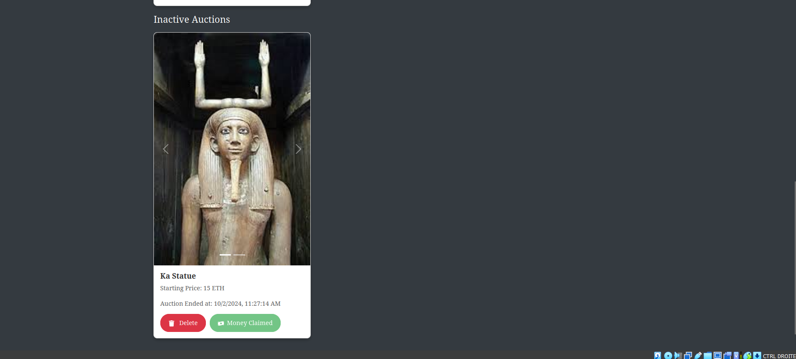
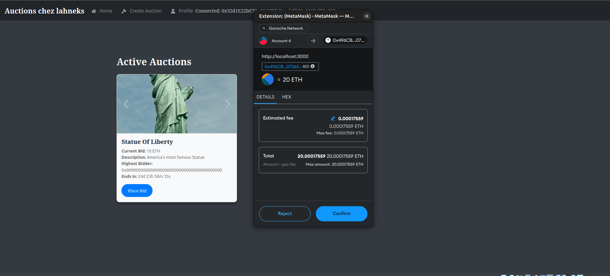

# Blockchain Auction

An Ethereum auction application built with Solidity, React, and Express. Connect a MetaMask wallet to create auctions, place bids, and manage your listings.

The project combines smart contracts for bidding and payments with an Express API and MongoDB for auction details and uploaded images.

[Watch the demo on YouTube](https://youtu.be/9Hzm0YKola8)

## Features

- **Wallet connection:** Connect MetaMask to submit transactions from your Ethereum account.
- **Auction creation:** Add a title, description, starting price, duration, and item photos.
- **Bidding:** Browse listings and submit bids through the smart contract. When a higher bid is accepted, the contract refunds the previous highest bidder.
- **Auction management:** View active and inactive listings, end your auctions, claim proceeds, and delete old listings from the application.

## Screenshots

### Connect with MetaMask



### Create an auction



### Active auctions



### Inactive auctions



### Place a bid



## How it works

1. A seller creates an auction through the React interface. MetaMask requests approval for the contract transaction.
2. The contract records the auction owner and deadline. The backend stores the listing details, photos, and associated blockchain auction ID.
3. Bidders submit ETH through MetaMask. The contract tracks the highest bid and refunds the previous highest bidder when a higher bid is accepted.
4. The seller uses the profile page to end an auction or claim its proceeds. The backend tracks the listing's display status.

Auction metadata and images are stored off-chain. Deleting a listing from the application does not remove its blockchain transaction history.

## Technology stack

| Component | Technologies |
| --- | --- |
| Frontend | React 18, Bootstrap, React Bootstrap, Web3.js |
| Backend | Node.js, Express, Mongoose |
| Storage | MongoDB, GridFS for uploaded images |
| Smart contracts | Solidity 0.8.19 |
| Local blockchain tools | Truffle, Ganache, MetaMask |

## Local setup

### Prerequisites

- Node.js and npm
- MongoDB running locally, or a MongoDB connection URI
- Truffle CLI available as `truffle`
- Ganache
- MetaMask installed in your browser

### 1. Clone the repository

```bash
git clone https://github.com/ahmedramibelghuith/Blockchain-Auction.git
cd Blockchain-Auction
```

If you already have a local copy, start from its root directory.

### 2. Install application dependencies

```bash
npm install --prefix auction-backend
npm install --prefix auction-app-front
```

The frontend currently imports `react-icons` without declaring it in its package manifest. Install it before starting the frontend:

```bash
npm install --prefix auction-app-front react-icons
```

### 3. Start the local blockchain and deploy the contract

Start Ganache with its RPC server at `http://127.0.0.1:7545`, matching `auction-app/truffle-config.js`.

From the repository root:

```bash
cd auction-app
truffle compile
truffle migrate --network development
cd ..
```

Copy the generated contract artifact into the frontend so it uses your deployment's ABI and network address:

```bash
cp auction-app/build/contracts/AuctionManager.json \
  auction-app-front/src/contracts/AuctionManager.json
```

Repeat deployment and the artifact copy if you reset the local blockchain.

### 4. Start the backend

With MongoDB running, open a terminal from the repository root:

```bash
cd auction-backend
node server.js
```

The API runs at `http://localhost:5000`. Its default MongoDB URI is `mongodb://localhost:27017/auction-db`.

To use a different database, provide `MONGO_URL` when starting the server:

```bash
MONGO_URL='mongodb://127.0.0.1:27017/auction-db' node server.js
```

### 5. Start the frontend

In another terminal, from the repository root:

```bash
cd auction-app-front
npm start
```

The frontend normally opens at `http://localhost:3000` and calls the API at `http://localhost:5000`.

### 6. Connect MetaMask

Add your Ganache network in MetaMask using the RPC URL above and the chain ID shown by Ganache. Import a Ganache development account, switch to that network, and connect it to the application. Use the account's local test ETH to create an auction and place bids.

## Project structure

```text
auction-app/          Solidity contract, Truffle configuration, migrations, and screenshots
auction-app-front/    React interface and contract artifact used by Web3.js
auction-backend/      Express API, auction data model, and image storage
```

